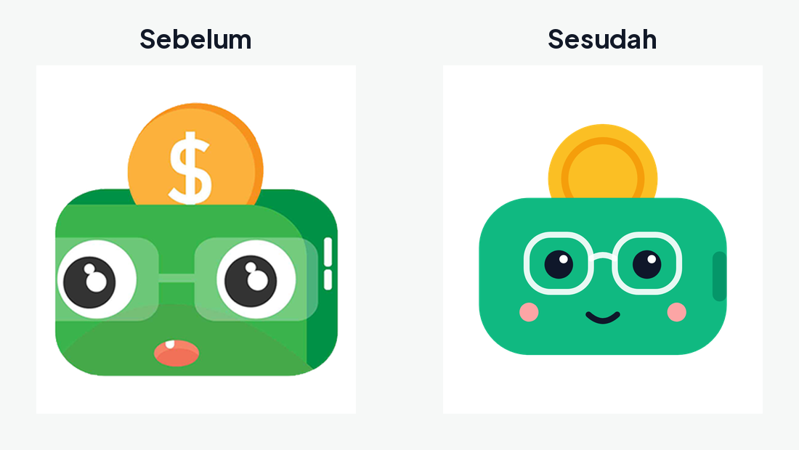
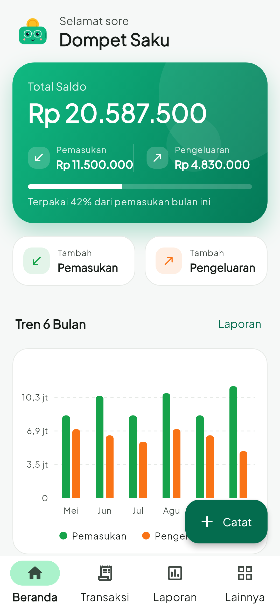
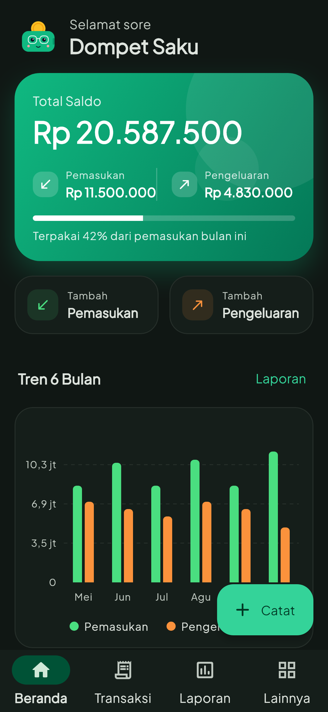
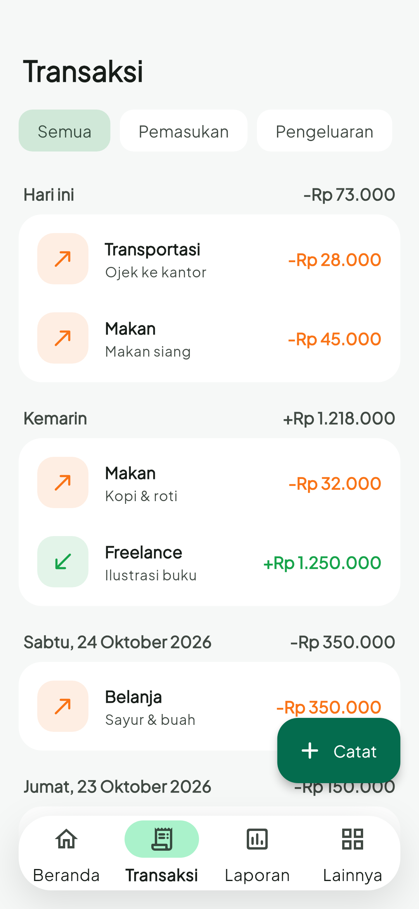
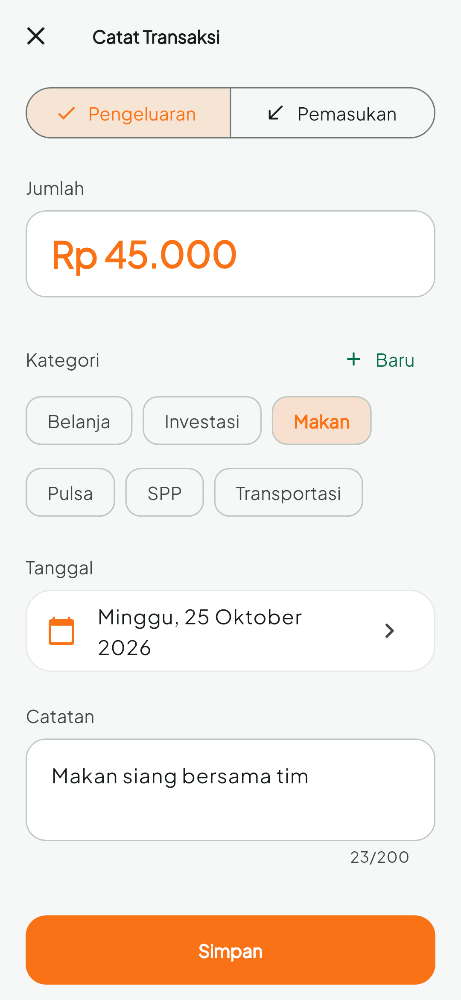
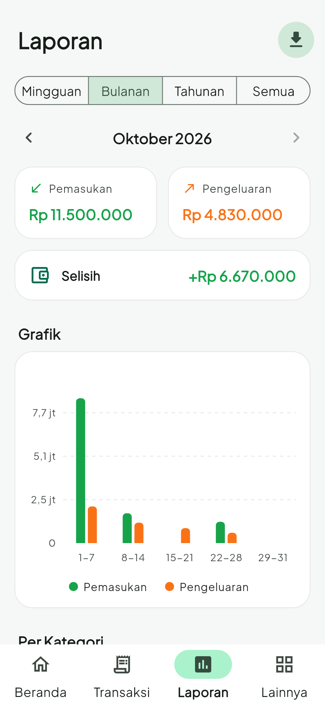
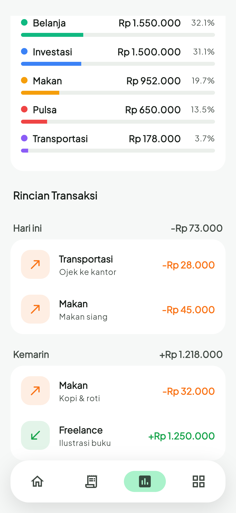
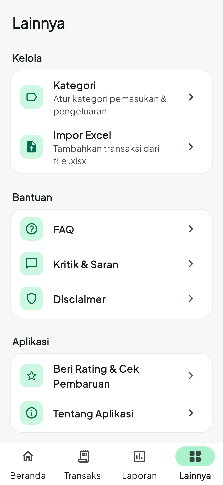
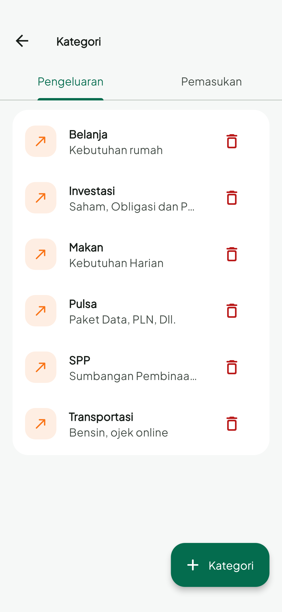

# DOKU — Dompet Saku

Aplikasi Android pencatat keuangan harian: catat pemasukan & pengeluaran,
kelola kategori, lihat laporan mingguan/bulanan/tahunan lengkap dengan grafik,
serta ekspor/impor Excel. Semua data disimpan lokal di perangkat (SQLite).

## Teknologi

- Flutter 3.47 / Dart 3.13 (Material 3, mode terang & gelap)
- Android saja (`com.caraguna.dompet_apps`), Gradle Kotlin DSL
- `sqflite` untuk database lokal, `fl_chart` untuk grafik,
  `excel_community` + `file_picker` untuk ekspor/impor,
  `google_mobile_ads` untuk iklan

## Struktur

```
lib/
  core/        tema, konstanta (AdMob, tautan), utilitas format & tanggal, widget bersama
  data/        database, model, repository, layanan (Excel, iklan, preferensi)
  features/    dashboard, transaksi, laporan, kategori, impor/ekspor, onboarding, lainnya
test/          unit test, test migrasi database, dan widget test
```

## Menjalankan

```bash
flutter pub get
flutter run
flutter analyze
flutter test
```

## Build rilis

Buat `android/key.properties` (tidak di-commit) yang menunjuk ke keystore upload:

```properties
storePassword=...
keyPassword=...
keyAlias=...
storeFile=/path/ke/keystore.jks
```

Lalu jalankan:

```bash
flutter build appbundle --release
```

Tanpa `key.properties`, build rilis memakai debug key (hanya untuk uji lokal).

## Catatan kompatibilitas

- Nama file database (`doku.db`), skema tabel, dan kunci SharedPreferences tetap
  sama seperti versi sebelumnya, sehingga data pengguna lama tetap terbaca.
  Database dinaikkan ke versi 2 (menambah index dan merapikan format tanggal
  hasil impor lama).
- File Excel memakai kolom: `Tanggal | Keterangan | Kategori | Jenis | Nominal`.

## Logo & ikon

Sumber logo ada di `docs/branding/logo.svg` (vektor). Turunannya:

- `assets/images/logo.png`: logo di dalam aplikasi dan splash screen
- `android/app/src/main/res/mipmap-*` dan `drawable-*/ic_launcher_*`: ikon launcher
  (adaptif + monokrom untuk themed icon Android 13+, plus ikon lama untuk Android 7)
- `assets/splash/splash_android12.png`: splash Android 12+
- `docs/branding/play_store_icon.png`: ikon 512×512 untuk Play Console



## Tampilan

| Beranda | Mode gelap | Transaksi | Catat transaksi |
|---|---|---|---|
|  |  |  |  |

| Laporan | Per kategori | Lainnya | Kategori |
|---|---|---|---|
|  |  |  |  |
